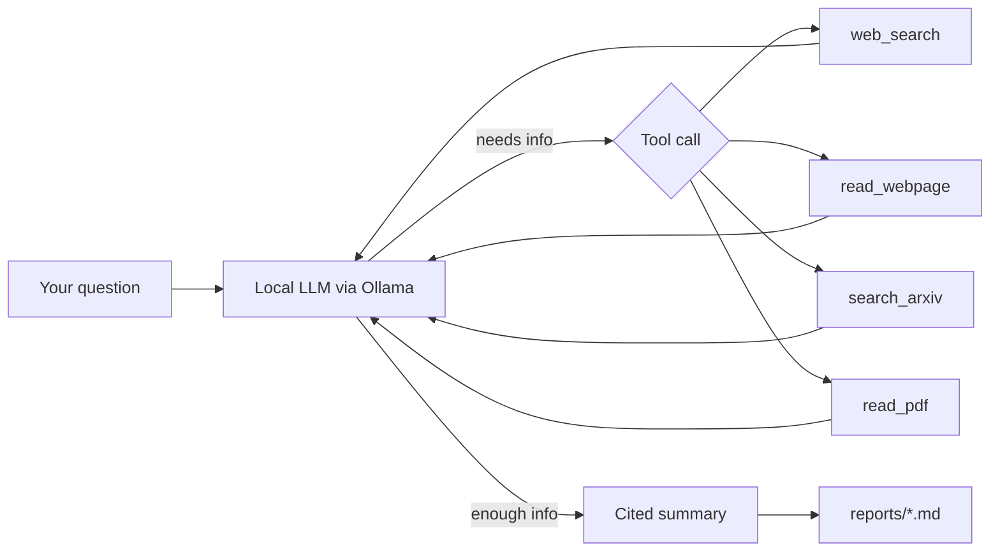

# Local Research Agent

A research assistant that runs **entirely on your own machine**. Ask a question, and the agent searches the web, reads the most relevant pages, and writes a cited summary, using an open-source LLM served locally by [Ollama](https://ollama.com). No API keys, no cloud LLM, no data leaving your laptop (apart from the web searches themselves).

## Features

- 🔎 **Web search** via DuckDuckGo (no API key needed)
- 📄 **Page reading**: fetches and cleans article text for the model to use
- 🧠 **Local LLM with tool calling** (Qwen3 by default; swap in any tool-capable Ollama model)
- 📝 **Cited answers**: every summary ends with a Sources list
- 💾 **Auto-saved reports**: each answer is written to a timestamped Markdown file in `reports/`
- 🧠 **Conversation memory**: ask follow-up questions; type `new` to start a fresh conversation
- 📚 **arXiv and PDF support**: search arXiv, then read papers and PDFs section by section

## How it works



The agent runs a simple loop: the model decides whether to call a tool, the code runs it, and the result is fed back to the model. This repeats (up to 10 steps) until the model writes its final answer.

## Prerequisites

- **Python 3.10+**
- **[Ollama](https://ollama.com/download)** installed and running
- Enough memory for your chosen model:

| Your machine | Suggested model |
|---|---|
| 8 GB RAM, no GPU | `qwen3:4b` |
| 16 GB RAM or 8 GB VRAM | `qwen3:8b` |
| 24 GB+ VRAM | `qwen3:14b` / `qwen3:32b` |

## Installation

```bash
# 1. Clone the repo
git clone https://github.com/<your-username>/local-research-agent.git
cd local-research-agent

# 2. (Optional) create a virtual environment
python -m venv .venv
.venv\Scripts\activate        # Windows
# source .venv/bin/activate   # macOS / Linux

# 3. Install dependencies
pip install -r requirements.txt

# 4. Download the model
ollama pull qwen3:8b
```

## Usage

```bash
python agent.py
```

Type a research question at the prompt:

```
Research question (or 'quit'): What are the main differences between LoRA and full fine-tuning?
  ... thinking
  -> using web_search({'query': 'LoRA vs full fine-tuning differences'})
  ... thinking
  -> using read_webpage({'url': 'https://...'})
  ...
[Saved to reports\2026-10-13_14-30_what-are-the-main-differences-between-lora.md]
```

Type `quit` (or press Enter on an empty line) to exit. Local models are slower than cloud ones, so expect a minute or two per question.

Type a research question at the prompt. Ask follow-ups like "go deeper on the second point" and the agent remembers the conversation (the last 5 exchanges). Type `new` to clear its memory, and `quit` (or press Enter on an empty line) to exit.

## Configuration

Edit the constants at the top of `agent.py`:

| Setting | Default | Description |
|---|---|---|
| `MODEL` | `qwen3:4b` | Any Ollama model that supports tool calling. Run `ollama list` to see what you have. |
| `REPORTS_DIR` | `reports` | Where Markdown reports are saved. |
| `num_ctx` | `8192` | Context window size. Raise it if you have the memory. |
| `max_steps` | `10` | Maximum tool-use steps per question. |
| `MAX_HISTORY_TURNS` | `5` | How many past question/answer pairs the agent remembers. |
| `CHUNK_CHARS` | `4000` | How much text the model reads per page or PDF part. |

## Project structure

```
local-research-agent/
├── agent.py            # the agent: tools, loop, report saving
├── requirements.txt    # Python dependencies
├── reports/            # generated reports (ignored by git)
├── README.md
├── LICENSE
└── .gitignore
```

## Troubleshooting

| Problem | Fix |
|---|---|
| `model '...' not found` | The `MODEL` name doesn't match what you pulled. Check `ollama list`. |
| `connection refused` | Ollama isn't running. Open the Ollama app or run `ollama serve`. |
| No output for a long time | Normal on CPU-only machines. Try a smaller model like `qwen3:4b`. |
| `Tool error` when reading a page | Some sites block scrapers. The agent usually tries another source. |
| Model answers from snippets without reading pages | Tighten the system prompt in `agent.py`, or try a larger model. |

## Limitations

- Small local models can misread sources or occasionally skip steps. Always check the cited links for important claims.
- Pages and PDFs are read in chunks of about 4,000 characters, and PDFs are capped at the first 40 pages.
- Scanned (image-only) PDFs can't be read.
- JavaScript-heavy sites may return little or no text.

## Roadmap

- [x] Web search and page reading tools
- [x] Save reports as Markdown
- [x] Conversation memory for follow-up questions
- [x] PDF and arXiv paper reading
- [ ] Verification step that cross-checks claims against a second source
- [ ] Domain-specific modes (e.g. AI papers, news, finance)

## License

Released under the [MIT License](LICENSE).
